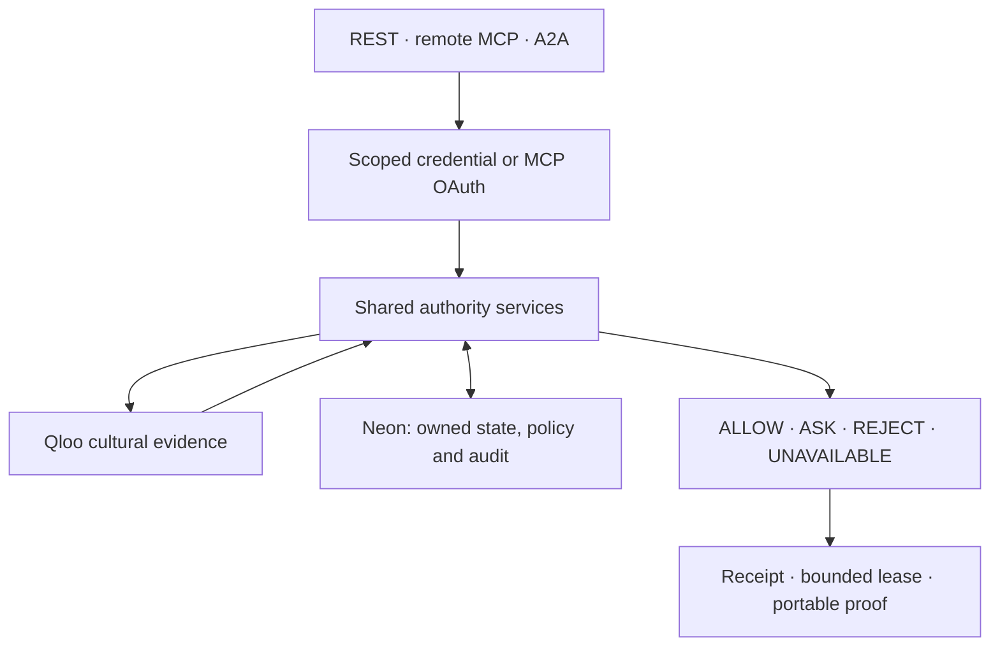

# Current architecture and authority boundary

TastePolicy is a production-hosted modular Next.js application at https://tastepolicy.vercel.app. This page describes implemented boundaries; the exact release/CI/deployment truth is in [the company ledger](../evaluation/company-build-m10-m26.md). Historical canonical architecture proposals and M1–M9 reports remain evidence of those checkpoints, not promises that every proposed feature is commissioned.

Qloo supplies resolved identities and cultural evidence. TastePolicy stores explicit reviewed signals, scoped constraints, contextual state, policy versions and captured decisions. Qloo affinity cannot override an applicable hard rule. An independent hard block can reject before a provider call; missing required evidence yields UNAVAILABLE rather than dislike or guessed permission. Provisional affinity thresholds are not human-calibrated assurance.

REST, MCP and A2A call the shared server services/contracts in src/lib/platform and src/server/platform. They do not contain independent permissive copies of the authorization engine. The TypeScript SDK is a bounded client, with a separate offline synthetic adapter and verifier kit. The SDK is packaged and consumer-tested, but npm publication is unproved. A2A protocol acceptance is separate from Google marketplace eligibility.

## Identity, access and tenants

Better Auth handles user accounts/sessions against the environment's dedicated PostgreSQL binding. Developer credentials are scoped, expiring and revocable; plaintext is issued once and hashes persist. Owner-sensitive account changes require recent sign-in and canonical same-origin validation. References identify records; they are not access grants. Cross-owner access requires a matching active scoped grant.

The OAuth authorization server is for public MCP clients: PKCE S256, CIMD/DCR, explicit owner consent, audience-bound access tokens, rotating refresh tokens and family reuse detection/revocation. The issuer/resource and all public metadata use centralized canonical-origin configuration. Production and preview have separate databases, roles and secrets. See CUSTOM_DOMAIN_MIGRATION.md for changing the temporary Vercel origin.

Workspaces/projects/environments/registered agents and immutable developer-key bindings are implemented. Workspaces currently have one owner. Environment namespaces do not provide physical database isolation or a fake-provider mode. Team membership, SAML/SCIM and enterprise RBAC are not implied. Tenant ownership checks, composite foreign keys and transaction locks are tested. Tables use RLS/PUBLIC revocation, but the application database owner bypasses RLS; RLS is not claimed as an independent per-request tenant enforcement layer.

## Decision and continuation lifecycle

The evaluator validates subject access and a current state snapshot, performs bounded provider work outside its owner-lock transaction phase, then rechecks access/version before committing a decision. Identical permitted retries replay captured results without new provider work; crash-before-commit may still repeat provider work. Receipts preserve captured evidence and policy/state commitments rather than rewriting history.

Policy can lower the allowed subjective-action ceiling and require clarification or explicit owner confirmation. An ASK is never an implicit approval. Leases are bounded, revocable and tied to an exact candidate/context and authority epoch. Drift, checkpoint expiry, grant/policy changes and revocation can suspend or end authority. Recorded dashboard states/epochs are historical views; fresh use requires fresh verification.

Portable proofs use explicit issuer trust, holder/audience/commitment checks and current status. Cryptographic validity, current authority and a relying party's execution authorization are different checks. No proof, receipt or ALLOW grants payment, booking, messaging, account changes, private-data disclosure or legal execution authority.

## Product and operations

The Boundary company shell covers public pages and the account control routes. Developer onboarding provides reviewed Qloo identities, a private Passport, scoped credential and owned application workspace. Rules, action ceilings, leases, captured decisions and timeline have authenticated control pages. The public Consumer Arena and judge route distinguish live Qloo paths, recorded evidence and unfinished external host commissioning.

Stripe TEST checkout/cancel/signed-webhook/invoice code is implemented with additive persistence. LIVE keys/entitlement changes are rejected. Provider account configuration and real test checkout acceptance are not yet commissioned. A pricing page and internal simulator are not live billing.

Application operational events contain only fixed surface/outcome enums, duration and timestamp. Provider hosting logs can separately contain ordinary request metadata; see the vendor register and retention limitations. An outside GitHub monitor checks public liveness/readiness/metadata. No delivered paging, durable metrics collector or contractual uptime/recovery SLA is claimed. A current-data isolated Neon clone/migration rehearsal is recorded; historical disaster recovery remains unproved.

MCP has an interactive Authority Card resource and accessible text fallback. Real TastePolicy tool invocation in ChatGPT and Claude remains a separate external acceptance gate. An actual ChatGPT prompt-only benchmark does not close it. Official MCP Registry publication is active; OpenAI/Claude directory submission, approval and publication remain distinct unresolved states.

## Diligence and evidence

- [Vendor/Qloo data foundation](../company/qloo-commercial-and-data.md): written commercial/output rights remain pending.
- [MCP annotation and UI audit](../company/mcp-tool-audit.md): read-only, destructive, open-world and idempotent behavior are explicit.
- [Operations and procurement](../security/operations.md) and [observability scope](../security/operations-observability.md).
- [Threat model](../security/threat-model.md), dated scan evidence, SBOM and dependency/IP ledger.
- [TasteBench methodology](../evaluation/tastebench-v2-methodology.md): synthetic component/gateway coverage, prompt-only observation and original human-pilot caveats are separate.

No certification, legal audit, external penetration test, exclusive Qloo partnership or verified paying traction follows from this architecture.
