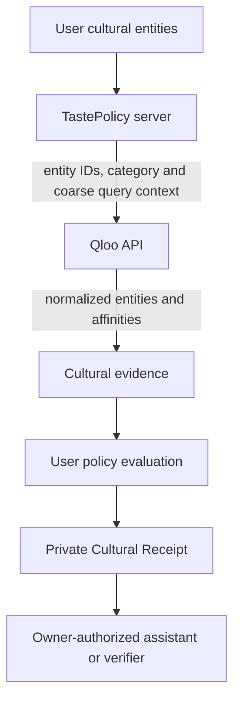

# Qloo dependency and data review

Reviewed 2026-10-28. This is an engineering/vendor diligence record, not legal advice or an obtained commercial license.

Sources: [Qloo terms](https://www.qloo.com/legal/terms), [privacy](https://www.qloo.com/legal/privacy), [official contact](https://www.qloo.com/company/contact), [API documentation](https://docs.qloo.com/), plus the founder's 2026-10-13 hackathon-access email (secret omitted).

## Permission and commercial state

The supplied credential is explicitly hackathon access. Its email gives an endpoint and key, but no commercial grant, SLA, retention allowance or expiry. Commercial use is **BLOCKED_EXTERNAL** pending written clarification. Inquiry sent to the published sales@qloo.com on 2026-10-28; Gmail message/thread `1a181f9bde4b46d0`. No response or commercial approval is claimed.

The public terms incorporate API-specific additional terms; restrict resale/redistribution and derivative services; retain Qloo IP/mark rights; grant Qloo broad rights to anonymized inputs; and provide no uninterrupted-service warranty. API caching, receipt retention and selective redistribution permissions are not established by the public page. Attribution/logo requirements, price, production quotas, support and availability commitments need a specific agreement. No public numeric commercial price was verified. A negotiated agreement may supersede the public terms. These are procurement blockers for paid Qloo-backed usage, not reasons to fabricate permission.

Qloo's privacy policy says its API does not accept PII and expects pre-anonymized cultural inputs; it may learn associations from entity arrays. Its policy excludes customer use of output from its own scope. Account/website retention is distinct from API-input/output retention; no TastePolicy deletion request can promise to erase associations already learned by Qloo. Contract clarification is required.

## Implemented provider boundary

`src/server/qloo/contracts.ts` supplies the provider contract; client/adapter/provider separate transport, normalization and composition. There is no live LLM replacement that can quietly fabricate Qloo evidence. Transport uses allowed Qloo hosts, no redirects, no HTTP cache, bounded bytes, timeout and five-call budget. Missing key, HTTP failure, malformed or missing evidence returns unavailable. Policy semantics preserve UNAVAILABLE rather than REJECT or ALLOW; evidence cannot change user authority.

## Data inventory and flow

Do not send account emails, user IDs, credentials, private policy text or payment data to Qloo. Entity search text can itself contain user-entered information: the UI and API must instruct users to enter public cultural entities only; stronger input classification remains a privacy hardening item, not a claimed guarantee.

Normalization retains entity ID, name, type and optional release year/address. Cultural evidence includes normalized affinity/scale, candidate and input-entity references, host/path/provenance and evidence time; receipt/state tables retain the decision inputs and reasons for replay. Raw HTTP response buffers are transient, not an application data-lake. Commons media provenance is presentation-only and never policy evidence. See `src/types/domain.ts`, adapter, receipt schemas and migrations for authoritative field definitions.

## Retention and deletion

Actual implementation: demo profiles expire; purge is opportunistic when new sessions are created and through operator purge scripts. Account Passport expiry is not deletion. Account export/deletion and cascading owned records exist; linked credentials/assistants are revoked. No unattended purge schedule or verified backup-deletion deadline is established. Production retention policy and scheduled enforcement must be completed before enterprise claims.

Operating rule: retain only fields required for an active user-requested decision/replay, no indefinite shared Qloo cache, no resale of entity catalogs, no model training on Qloo output. Commercial receipt/proof retention and onward disclosure require Qloo's written agreement. On account deletion remove application-owned records and invalidate authority, then handle vendor requests separately. Backups can outlive live records; exact provider retention must be verified before promising a deadline.

## Dependency risk

A key can expire or be withdrawn, price can change and service can fail. New evidence-dependent decisions fail closed; an outage never raises an action ceiling or revives an epoch. Existing leases are checked against their own expiry, epoch and evidence conditions. Provider substitution must be explicit, versioned and separately tested, with visible provenance and fresh authority evaluation. Do not claim recommendation relevance or commercial continuity from synthetic conformance tests.
