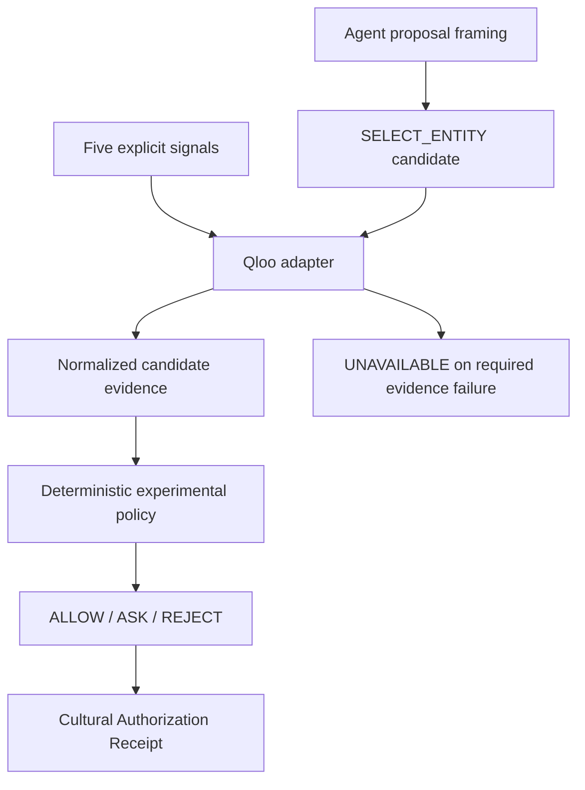

# TastePolicy submission preparation

Status: **DRAFT SUBMISSION MATERIALS — M1.5R implementation complete; final submission and recording remain pending**. This is not a Devpost submission or merge authorization. Implementation truth is the latest verified merged main; M1.5R was developed over M1 baseline 84636d6e502e0686db6dc9a483f6908cd466ccf9. Product direction is [canonical architecture v2](../architecture/canonical-architecture-v2.md).

**Project:** TastePolicy. **Category/tagline:** Cultural authorization for AI agents. **Core insight:** Permission is not preference.

## Problem and solution

Technical permission does not answer whether a subjective action fits the human. TastePolicy evaluates a specific SELECT_ENTITY proposal using five explicit cultural signals, Qloo-grounded candidate evidence and a deterministic experimental policy. It returns ALLOW, ASK or REJECT with an auditable Cultural Authorization Receipt. Required missing evidence produces UNAVAILABLE. Cultural ALLOW grants no spending, booking, legal or account authority.

## Why Qloo is indispensable

Qloo provides cultural intelligence: entity resolution, cross-domain discovery, candidate-specific evidence and explainability where available. TastePolicy provides authorization semantics, deterministic policy, explicit uncertainty, refusal to fabricate and receipts. Provider payloads stop at the adapter. TastePolicy does not own Qloo's cultural graph and no LLM decides policy.

A recommender asks “What might this user like?” TastePolicy asks “Is this specific subjective action culturally justified under the configured policy?” Discovery is a way to choose a proposal; its rank is not authorization.

## Current implementation

The UI frames an agent proposal; a public Agent Gateway/SDK/MCP and machine continuation contract are not implemented. [M1 live acceptance](../evaluation/milestone-1-live-acceptance-2026-10-13.md) established real identities, unit wire affinity, candidate evidence, receipts, repeat and unmocked browser proof. Those historical observations are not current-session evidence. Every new demo must resolve/select identities and request fresh evidence.

## Judge-criteria positioning

| Criterion                    | Evidence-backed story                                                                                                                           | Honest limit                                                                         |
| ---------------------------- | ----------------------------------------------------------------------------------------------------------------------------------------------- | ------------------------------------------------------------------------------------ |
| Technological implementation | Server-only integration, contract validation, candidate-specific evidence, deterministic policy, versioned receipts, bounded unavailable states | Experimental thresholds; process-local quotas; no production-scale reliability claim |
| Design                       | Guided Judge Mode, proposal/control UX, readable evidence/provenance, accessible mobile disclosures                                             | Lightweight accessibility checks are not a full accessibility certification          |
| Potential impact             | Subjective mistakes matter more when an agent acts; cultural authorization may be reusable infrastructure                                       | Adoption, willingness to pay and measurable human alignment are hypotheses           |
| Quality of idea              | Permissions govern capability; TastePolicy supplies a cultural-policy boundary grounded in Qloo                                                 | No generalized recommendation superiority claim                                      |

## Submission checklist

- Verify actual event rules/rubric and eligibility separately before submission; this document does not establish eligibility.
- Require independent review and explicit approval for repository merges; historical reconciliation records are not merge authorization.
- Capture fresh real responses for the final recording; keep LIVE QLOO, RECORDED LIVE EVIDENCE, SYNTHETIC TEST DATA and UNAVAILABLE distinct.
- Include setup, Apache 2.0 license, provider provenance, experimental threshold rationale and limitations.
- Inspect screenshots for secrets; never remove synthetic labels or force an outcome for narrative convenience.
- Follow v2 ordering: M1 → M1-T → M1.5R → M1.6 → M2 → M2.5 → M3 → M4 → M5 → M6 → M7. Later milestones require separate scope approval and verification.

## Future, not implemented

Persistent Taste State, ContextGraph, scoped feedback, Stability, Comparison Mode, Clarification Planner, Counterfactual Repair, TasteBench, TasteTrajectory, TasteProxy, Agent Gateway/SDK/MCP, authentication, payments and execution remain future. Qloo affinity is query/context-relative aggregate evidence, not individual preference probability. Thresholds remain >0.80 ALLOW, 0.50–0.80 inclusive ASK, <0.50 REJECT, experimental and not human-calibrated.
