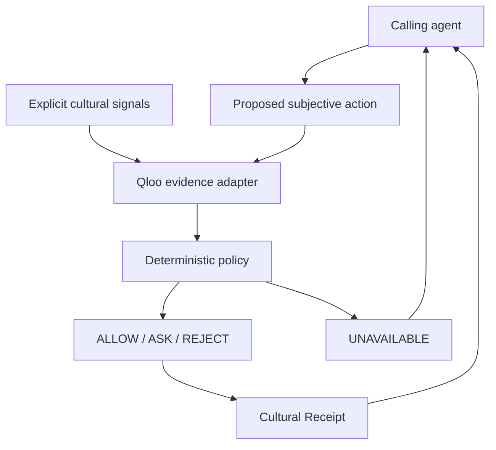

# TastePolicy submission preparation

Status: **DRAFT — LIVE QLOO PROOF PENDING**. M1.5 is stacked on frozen M1, not a submission or a merge. This document describes implemented architecture and intended live behavior separately. No resolved canonical IDs, real affinity values, human-study results or market-size claims are supplied.

## Project

**Name:** TastePolicy  
**Tagline:** Cultural authorization for autonomous AI agents.  
**Insight:** Permission is not preference.

Agents increasingly act for people, but technical permission does not establish whether a subjective choice fits the human. TastePolicy checks a proposed SELECT_ENTITY action against explicit cultural signals, Qloo-grounded evidence and a deterministic experimental policy. Successful evidence evaluation produces ALLOW, ASK or REJECT with a Cultural Receipt. Missing required evidence produces UNAVAILABLE rather than an invented decision.

The code implements this path; real-data acceptance is still blocked on the event-issued Qloo credential and the independent live acceptance protocol. No autonomous execution occurs. ALLOW concerns cultural policy only; spending, booking, account access and legal authority remain separate.

## Why Qloo is indispensable

Qloo supplies the cultural-intelligence substrate: entity resolution, cross-domain discovery/evidence, candidate-specific cultural evidence and explainability where supported. TastePolicy supplies authorization semantics, deterministic policy, explicit uncertainty and Cultural Receipts. We do not own Qloo's cultural graph or ask an LLM to invent it. Actual account-specific wire behavior remains to be verified.

## Isn't this a recommender?

A recommender asks, “What might this user like?” TastePolicy asks, “Should an autonomous agent be culturally permitted to make this specific subjective choice under the configured policy?” Ranked discovery helps choose a proposal; a separate candidate-specific query grounds evaluation. Discovery rank is not authorization.

## Architecture

The current UI frames a proposal; it does not implement an autonomous agent transport. Server-only transport and adapters terminate provider payloads; policy consumes normalized evidence; receipts capture raw/configured-scale/normalized scores, thresholds and provenance. UNAVAILABLE does not create a fabricated successful receipt. See the repository architecture and policy documents for exact implemented boundaries.

**FUTURE / NOT CURRENT M1:** persistent Taste State, ContextGraph, scoped persistent feedback, cross-agent propagation, SDK/MCP and TasteBench. M1.5 implements none of them.

## Judge criteria mapping

| Criterion                    | Current engineering story                                                                                                                                        | Evidence still required                                                                     |
| ---------------------------- | ---------------------------------------------------------------------------------------------------------------------------------------------------------------- | ------------------------------------------------------------------------------------------- |
| Technological implementation | Server-only provider boundary, candidate-specific request construction, normalized contracts, deterministic policy, safe unavailable results, versioned receipts | Live contract verification, actual candidate evidence, score semantics, regression fixtures |
| Design                       | Evidence/control UX, distinct policy states, inspectable provenance, keyboard controls, decision-first mobile output                                             | Final live browser flow after credential provisioning                                       |
| Potential impact             | Subjective choices become consequential as agents move from suggestion to action; a cultural policy boundary could be reusable infrastructure                    | Human alignment and commercial adoption remain hypotheses                                   |
| Quality of idea              | Capability permission differs from cultural fit; Qloo supplies cultural substrate and TastePolicy supplies policy semantics                                      | Real-data mechanism proof before performance claims                                         |

## Submission checklist

- Verify the actual event rules/rubric before submitting; this preparation document does not assert eligibility or current judging weights.
- Complete M1 live acceptance, security/quota review and final independent review at an exact SHA.
- Record actual request-to-result provenance, five reviewed identities and at least three genuine evaluations.
- Capture unmocked live screenshots/video only after verification; identify unavailable explainability honestly.
- Include reproducible setup, Apache 2.0 license, known limitations and score-policy rationale.
- No fabrication of participants, scores, causal claims, individual preferences or future behavior.
- Do not submit Devpost materials, merge either PR or start M2 during this pass.

## Limitations

Current thresholds remain experimental and not live-calibrated. No persistent personalization, verified alignment improvement, generalized recommendation superiority, consumer authentication, payments, SDK/MCP or autonomous action is claimed. Qloo affinities describe aggregate relationships, not individual certainty. Commercial thesis: reusable preference-sensitive policy infrastructure; willingness to pay and defensibility need later validation.
